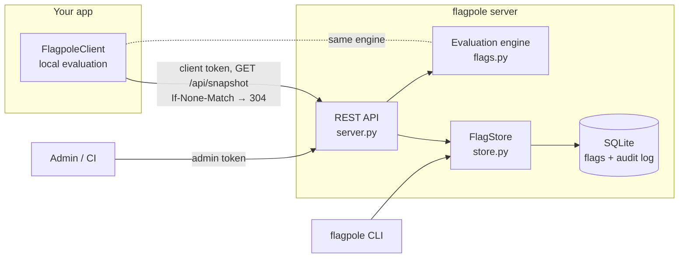

# flagpole

[](https://github.com/zeexduaa/flagpole/actions/workflows/ci.yml)


[](LICENSE)

**A small, self-hosted feature-flag service: targeting rules, percentage rollouts, an audit log, a REST API and a Python SDK that evaluates flags locally.**

Ship code dark, turn it on for staff, then for 10% of users, then for everyone, without redeploying. flagpole is a single Python package with no dependencies and a SQLite file, so it runs anywhere Python does.

- **Who it's for:** small teams and side projects that want feature flags without a SaaS bill or a heavyweight platform.
- **Built with:** Python 3.11+ standard library only (`http.server`, `sqlite3`, `hashlib`), pytest, GitHub Actions on Linux, macOS and Windows.

> Status: **early (v0.1)**. The core works and is well tested; environments, a web UI and more SDKs are on the [roadmap](ROADMAP.md).

## Quick start

```
pip install git+https://github.com/zeexduaa/flagpole.git
flagpole serve --dev          # prints throwaway admin and client tokens
```

Create a flag (admin token) and evaluate it (client token):

```
curl -X POST http://127.0.0.1:8080/api/flags \
  -H "Authorization: Bearer $ADMIN" -H "Content-Type: application/json" \
  -d @examples/new-checkout.json

curl -X POST http://127.0.0.1:8080/api/evaluate \
  -H "Authorization: Bearer $CLIENT" -H "Content-Type: application/json" \
  -d '{"context": {"key": "user-2", "country": "DE", "plan": "pro"}}'
```

```json
{"results": {"new-checkout": {"flag": "new-checkout", "variant": "on", "value": true,
             "reason": "rule_match_rollout", "rule": 1, "version": 1}}}
```

Or check flags from Python, with no network call per check:

```python
from flagpole.client import FlagpoleClient

with FlagpoleClient("http://127.0.0.1:8080", token=CLIENT) as flags:
    if flags.is_enabled("new-checkout", {"key": user.id, "country": user.country, "plan": user.plan}):
        show_new_checkout()
```

Output of [`examples/sdk_quickstart.py`](examples/sdk_quickstart.py) against the example flag:

```
user-1: new checkout ON   (rule_match)
user-2: new checkout ON   (rule_match_rollout)
user-3: new checkout off  (default_rollout)
```

## How flags work

A flag has named **variants**, and evaluating it for a **context** (the user or request) picks one:

```json
{
  "key": "new-checkout",
  "enabled": true,
  "variants": { "on": true, "off": false },
  "off_variant": "off",
  "rules": [
    { "conditions": [{ "attribute": "email", "op": "ends_with", "value": "@example.com" }],
      "serve": { "variant": "on" } },
    { "conditions": [{ "attribute": "country", "op": "in", "value": ["DE", "AT"] },
                     { "attribute": "plan", "op": "eq", "value": "pro" }],
      "serve": { "rollout": { "on": 50, "off": 50 } } }
  ],
  "default": { "rollout": { "on": 10, "off": 90 } }
}
```

1. A disabled flag always serves `off_variant` (reason `disabled`).
2. Otherwise the **first rule** whose conditions **all** match decides (`rule_match`).
3. Otherwise `default` decides (`default`).

Rules and the default serve a single variant or a **percentage rollout**. Variants can be any JSON: booleans, strings, numbers, objects. A flag created with just a key is a disabled on/off flag.

**Operators:** `eq` `neq` `in` `not_in` `contains` `not_contains` `starts_with` `ends_with` `matches` (regex) `gt` `gte` `lt` `lte` `exists` `not_exists`. Attributes can be nested (`account.plan`). Comparisons are strictly typed: `true` never equals `1`, and `"1"` never equals `1`. A missing attribute only matches the negative operators.

**Rollouts** hash the flag key with the context's `bucket_by` attribute (`key` by default) into 10,000 buckets:

- the same user always gets the same variant;
- different flags split users independently;
- raising a rollout from 10% to 30% keeps everyone who already had it;
- if the bucketing attribute is missing, the flag safely serves `off_variant` (`missing_bucket_attribute`).

## Architecture



| Module       | Responsibility                                                                 |
|--------------|---------------------------------------------------------------------------------|
| `flags.py`   | Flag model, validation (errors carry the field path) and evaluation. Pure: no I/O. |
| `store.py`   | SQLite storage: versions, audit log, revision counter, schema migrations.       |
| `server.py`  | HTTP routing, auth, errors and ETags on top of `http.server`.                   |
| `client.py`  | SDK: snapshot download, background refresh, local evaluation, safe fallbacks.   |
| `cli.py`     | `serve`, flag management, `eval`, `audit`, `export`.                            |

### Design decisions

- **One evaluation engine everywhere.** The server, CLI and SDK import the same `flags.py`, so a flag can't behave differently in different places.
- **Local evaluation in the SDK.** Apps download all flags and evaluate in-process, so a flag check costs microseconds and keeps working when the server is down. Idle refreshes are a single `304 Not Modified`.
- **No lost updates.** Every flag has a `version`. Send `If-Match: "3"` and the write fails with `412` if someone changed the flag since you read it.
- **Every change is audited** (who, what, before and after) in the same transaction as the change.
- **Fail safe.** Unknown flags, a missing bucketing attribute or an unreachable server fall back to the off variant or the caller's default, never to an exception in your request path.

## API

Full reference: [`docs/API.md`](docs/API.md).

| Method & path                         | Token  | Purpose                                       |
|---------------------------------------|--------|-----------------------------------------------|
| `GET /health`                         | none   | Liveness and current revision                 |
| `GET /api/flags[?tag=]`               | admin  | List flags                                    |
| `POST /api/flags`                     | admin  | Create a flag                                 |
| `GET /api/flags/{key}`                | admin  | Get one flag (`ETag: "<version>"`)            |
| `PUT /api/flags/{key}`                | admin  | Replace a flag (`If-Match` optional)          |
| `POST /api/flags/{key}/enable` / `disable` | admin | Toggle (`If-Match` optional)            |
| `DELETE /api/flags/{key}`             | admin  | Delete                                        |
| `GET /api/audit[?flag=&limit=&before=]` | admin | Change history, newest first                 |
| `GET /api/snapshot`                   | client | All flags for SDKs (`ETag`, `304`)            |
| `POST /api/evaluate`                  | client | Evaluate one or more flags for a context      |

Add `X-Flagpole-Actor: sam@example.com` to admin requests to record who made a change.

## CLI

```
flagpole serve [--host 127.0.0.1] [--port 8080] [--dev]
flagpole flags list [--tag TAG]
flagpole flags create KEY [--description TEXT] [--json FILE]
flagpole flags update KEY --json FILE [--if-version N]
flagpole flags enable KEY | disable KEY | show KEY | delete KEY [--yes]
flagpole eval KEY --context '{"key": "user-1", "country": "DE"}'
flagpole audit [--flag KEY] [--limit N]
flagpole export > snapshot.json
```

The database is `flagpole.db` by default; use `flagpole --db path/to/file.db ...` or set `FLAGPOLE_DB`.

## Configuration

| Variable                | Meaning                                                          |
|-------------------------|------------------------------------------------------------------|
| `FLAGPOLE_ADMIN_TOKEN`  | Full access. At least 16 characters.                             |
| `FLAGPOLE_CLIENT_TOKEN` | Read and evaluate only, for your apps. Must differ from admin.   |
| `FLAGPOLE_DB`           | SQLite file (default `flagpole.db`).                             |

Put them in a `.env` file (git-ignored; see [`.env.example`](.env.example)) or the environment. The server listens on `127.0.0.1` by default. Put it behind HTTPS (a reverse proxy such as Caddy or nginx) before exposing it. See [SECURITY.md](SECURITY.md).

## Development

```
git clone https://github.com/zeexduaa/flagpole.git
cd flagpole
python -m venv .venv && source .venv/bin/activate    # Windows: .venv\Scripts\activate
pip install -e ".[dev]"
pytest
```

The tests start real servers on random ports and cover the engine, the store (including concurrent writers), the API, the SDK and the CLI.

## License

[MIT](LICENSE) © 2026 Syed Ali
